# github-stats

Self-hosted GitHub stats cards for [md-saqib](https://github.com/md-saqib), styled to match [mdsaqib.is-a.dev](https://mdsaqib.is-a.dev). A daily GitHub Action queries the GitHub API and commits fresh SVGs to [`generated/`](generated).

<picture>
  <source media="(prefers-color-scheme: dark)" srcset="generated/overview-dark.svg">
  
</picture>
<picture>
  <source media="(prefers-color-scheme: dark)" srcset="generated/languages-dark.svg">
  
</picture>
<picture>
  <source media="(prefers-color-scheme: dark)" srcset="generated/activity-dark.svg">
  
</picture>
<picture>
  <source media="(prefers-color-scheme: dark)" srcset="generated/mix-dark.svg">
  
</picture>
<picture>
  <source media="(prefers-color-scheme: dark)" srcset="generated/rhythm-dark.svg">
  
</picture>

## Cards

| Card | Shows |
| --- | --- |
| `overview` | Contributions, stars, repositories, lines changed, views (14 days), forks |
| `languages` | Top languages by code size |
| `activity` | Last-12-months heatmap, current and longest streak, best day |
| `mix` | Commits, pull requests, reviews, issues and new repos over the last year |
| `rhythm` | Contributions by day of the week |

Each card is written as `<card>-dark.svg` and `<card>-light.svg`.

## Setup

1. Create a [personal access token](https://github.com/settings/tokens) (classic) with `read:user` and `repo` scopes.
2. Add it as the repository secret `ACCESS_TOKEN`.
3. Optional secrets: `EXCLUDED` (comma-separated `owner/repo` list) and `EXCLUDED_LANGS` (comma-separated languages).
4. Run **Actions → Generate stats cards → Run workflow**, or wait for the daily run at 00:17 UTC.

## Embedding

```html
<picture>
  <source media="(prefers-color-scheme: dark)" srcset="https://raw.githubusercontent.com/md-saqib/github-stats/master/generated/overview-dark.svg">
  
</picture>
```

## Credits

Based on [jstrieb/github-stats](https://github.com/jstrieb/github-stats), licensed under GPL-3.0.
